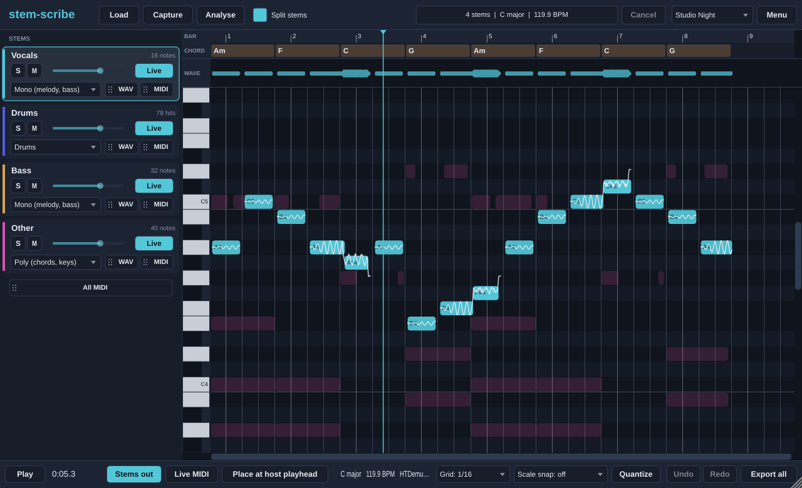

# stem-scribe

A stem splitter and audio-to-MIDI transcriber (VST3, AU on macOS, and a standalone app).
Load or drag in a song, or capture the track the plugin sits on, and stem-scribe splits it into
drums, bass, vocals and "other" with HTDemucs, then turns each stem into editable MIDI:
a pitch tracker for bass and vocals (pitch curve drawn over the notes, ReaTune-style, with bends),
Basic Pitch for chords and keys, and an onset classifier for drums. It also finds the tempo, the key
and the chords. Notes and chords can be edited in the piano roll, and stems and MIDI can be dragged
straight into the DAW or exported. Everything runs offline on the CPU. See `docs/DESIGN.md`.



## Build

```
cmake -B build -DCMAKE_BUILD_TYPE=Release     # fetches JUCE 8.0.4 and demucs.cpp (pinned)
# or: cmake -B build -DJUCE_DIR=/path/to/JUCE -DDEMUCS_CPP_DIR=/path/to/demucs.cpp
cmake --build build --config Release
ctest --test-dir build                         # engine tests
```

Engine only (no JUCE): `-DSTEMSCRIBE_BUILD_PLUGIN=OFF`. Without the separator: `-DSTEMSCRIBE_WITH_DEMUCS=OFF`
(transcription of the full mix still works).

macOS builds target macOS 11+ universal (Intel + Apple Silicon). No AVX2 or other `-march` flags are
used; Eigen picks SSE2 or NEON by itself. Windows builds use the static runtime.

## The separation model

The HTDemucs weights (`ggml-model-htdemucs-4s-f16.bin`, about 81 MB) are not in the repository.
The CI `model` job converts the official Demucs v4 weights with demucs.cpp's
`scripts/convert-pth-to-ggml.py` (falling back to demucs.cpp's pre-converted file on Hugging Face),
caches the result, and bundles it in both installers. For a local build, do the same:

```
git clone https://github.com/sevagh/demucs.cpp && cd demucs.cpp && git submodule update --init vendor/demucs
pip install torch --index-url https://download.pytorch.org/whl/cpu && pip install ./vendor/demucs numpy
python scripts/convert-pth-to-ggml.py ./out
```

then put the file in `/Library/Application Support/YourBrand/stem-scribe/` (macOS),
`%PROGRAMDATA%\YourBrand\stem-scribe\` (Windows), point `STEMSCRIBE_MODEL` at it, or choose it from
the plugin's Menu. `STEMSCRIBE_TEST_MODEL=<file> ctest` also runs a real separation test.

## Command line

`stemscribe_cli song.wav out_dir [--no-split] [--mode poly|mono|drums] [--model file] [--threads n] [--bpm x] [--no-chords]`
writes one WAV and one .mid per stem, a combined .mid, and the chord list, and prints the time each
stage took.

## Installers

GitHub Actions builds `stem-scribe-<version>-mac.dmg` (a .pkg with VST3, AU, app and model choices)
and `stem-scribe-<version>-windows-setup.exe` on every push, runs the tests on all three platforms,
and publishes both to a GitHub Release on `main` and on `v*` tags. The builds are unsigned.

## Layout

- `Source/engine`: plain C++ with no JUCE. Audio I/O, DSP, the HTDemucs separator, the Basic Pitch
  graph runner, the pYIN-style tracker, drums, tempo, key and chords, the MIDI writer, and the cache.
- `Source/plugin`: the JUCE processor, editor, piano roll, stem list and the five themes.
- `tests/EngineTests.cpp`, `tools/` (CLI, screenshot renderer, processor smoke test, Basic Pitch exporter).
- `packaging/`: the macOS and Windows installer scripts.

Screenshots: configure with `-DSTEMSCRIBE_BUILD_SCREENSHOT=ON`, build `stemscribe_screenshot`, then run
`xvfb-run -a build/stemscribe_screenshot_artefacts/Release/stemscribe_screenshot docs` on Linux.

## Licences

stem-scribe uses demucs.cpp (MIT), the Demucs v4 weights (MIT), Eigen (MPL 2.0, used in
`EIGEN_MPL2_ONLY` mode), Basic Pitch (Apache 2.0) and JUCE. See `THIRD_PARTY_NOTICES.md`.
